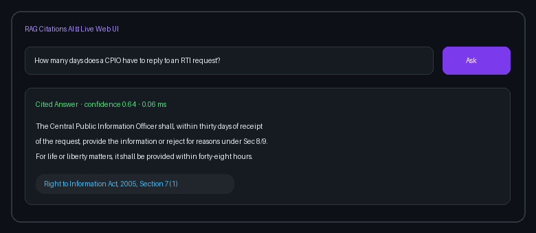
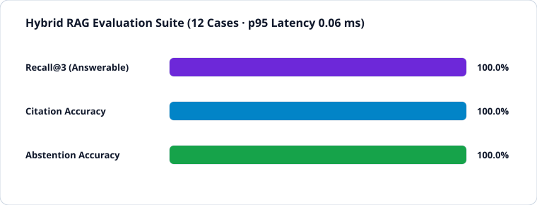

# RAG Citations AI

[](https://www.python.org/)
[](https://fastapi.tiangolo.com/)
[](app/retriever.py)

**Plain-language answers about Indian statutory & digital rights, with every claim linked to the exact Act and Section — and explicit abstention when evidence is missing.** Supports English and Hinglish queries, runs 100% locally with zero paid GPU, and optionally plugs into any OpenAI-compatible LLM (Ollama, Groq, OpenRouter).



| **100%** | **100%** | **100%** | **0.06 ms** |
| :---: | :---: | :---: | :---: |
| Recall@3 across answerable queries | Citation accuracy (exact Act & Section) | Abstention accuracy on out-of-scope queries | p95 retrieval + synthesis latency |

<picture>
  <source media="(prefers-color-scheme: dark)" srcset="docs/img/eval-dark.svg">
  
</picture>

Full 12-case evaluation table: **[docs/EVALS.md](docs/EVALS.md)**.

---

## Architecture

<picture>
  <source media="(prefers-color-scheme: dark)" srcset="docs/img/architecture-dark.svg">
   BM25 + TF-IDF RRF Reranking -> Evidence Gate -> Cited Answer" src="docs/img/architecture-light.svg">
</picture>

- **Hybrid Retrieval + RRF:** Combines BM25 lexical matching with TF-IDF cosine similarity and Reciprocal Rank Fusion, plus Hinglish-to-English legal term normalization.
- **Evidence Gate (No Hallucinations):** Queries scoring below `confidence_threshold` are declined instead of guessing.
- **Built-in Web UI:** Visit `http://localhost:8000` after starting the server to test queries interactively.

---

## Quickstart

```bash
python3 -m venv .venv
source .venv/bin/activate
pip install -r requirements.txt

# 1. Run tests & 12-case eval suite
pytest -v
python scripts/run_eval.py

# 2. Launch FastAPI + Web UI
uvicorn app.main:app --host 0.0.0.0 --port 8000
```
